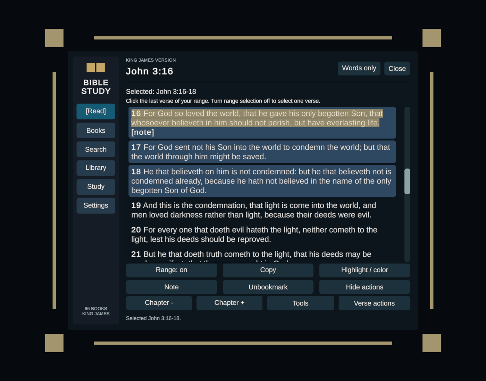
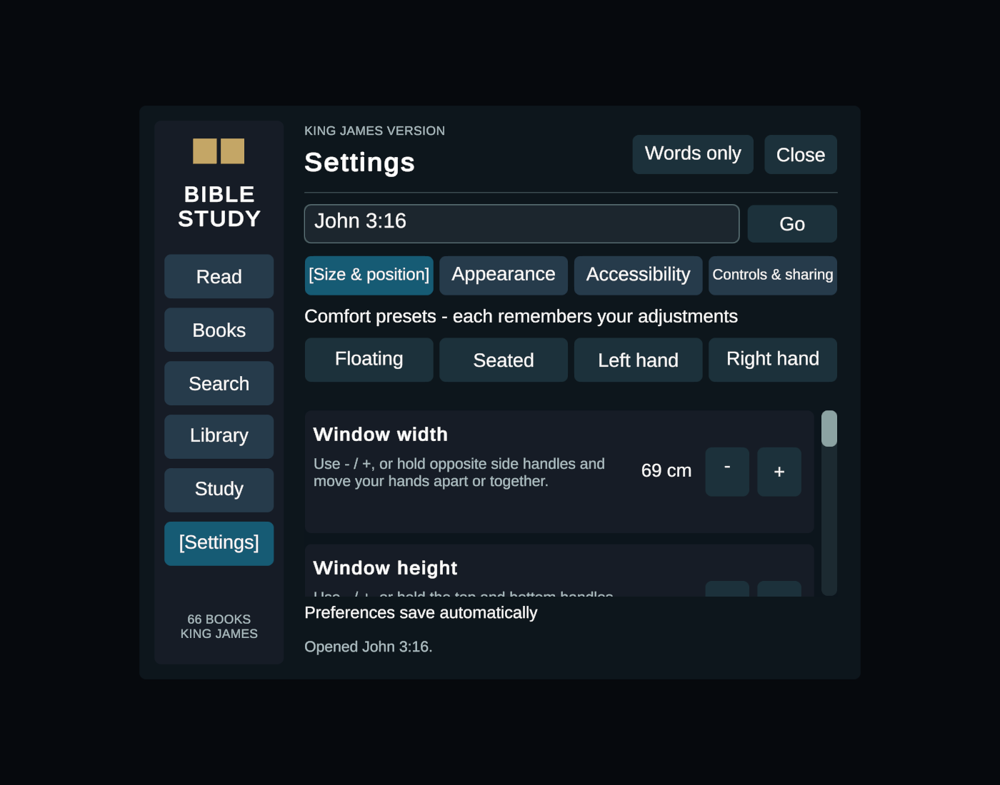

# VRChat Bible - KJV

Free, offline Bible for VRChat worlds, created and maintained by **Cristian2737**.
All 66 KJV books are included. Donations are optional support for this project
and the creator's future projects. Every feature is free.

[Download the release](https://github.com/Cristian2737/vrchat-bible/releases/latest) |
[Report a bug or request a feature](https://github.com/Cristian2737/vrchat-bible/issues/new/choose) |
[Creator on itch.io](https://cristian2737.itch.io/)



## Install

Use one distribution format in an existing VRChat Worlds project:

1. Download `VRChatBible-1.0.0.unitypackage` from Releases and import it,
   or add the VCC repository URL below and install `com.cristian2737.bible`.
2. Open your world scene and select **Tools > VRChat Bible > Add Bible to Open Scene**.
3. Place the launcher/hosting station, validate through the same menu, and save.

VCC repository URL:

```text
https://cristian2737.github.io/vrchat-bible/index.json
```

The installer preserves existing scene objects and the world ID. Repeating
installation selects/validates the existing Bible. Adding it supports Undo.
The package includes its own font, materials and sound.

[Full installation, updating and removal instructions](Package/Documentation/Installation.md).
Test environment: Unity 2022.3.22f1 / Worlds SDK 3.7.5. Newer SDK/editor versions
need their own compatibility checks. Install one Bible system per world.

## Features

- Grouped Old/New Testament navigation; book, chapter and verse selection.
- Continuous touch-selectable reading, reference ranges and full Bible search.
- Personal notes, highlights, bookmarks, history and saved reading position.
- Independent width/height, hand manipulation, pinning and smooth following.
- View/controller attachment, comfort presets, opacity, outlines and themes.
- Owner/delegated study hosting, shared scripture and viewer-local screens.



## Free use, support and contributions

Original code, UI, sound and documentation are dedicated under **CC0**.
Use, modify and redistribute them freely, including commercially. Credit is
appreciated. Third-party material keeps its own notices; see [LICENSE.md](LICENSE.md).
No exclusive rights are claimed over the Bible text.

The official download stays free. The itch.io release can accept optional
donations; donating is never required to use the Bible or request a feature.
The creator profile is linked above; the project page will be linked once published.

Use Issues for bugs and feature requests. See [CONTRIBUTING.md](CONTRIBUTING.md)
and [support information](Package/Documentation/Support.md).

## Verification and limits

The v1.0.0 package passed independent Unity/VPM installation checks, the
full ClientSim UI/rejoin regression suite, and PC/Android local SDK builds.
See [the verification report](Release/verification-result.txt) for exact scope.
Physical VR/controller hardware, live multiplayer transport and VRChat cloud
persistence still need in-world playtests.

Notes/progress are saved separately per world. This is a world asset; the
avatar-native arm Bible remains a separate future project.

## Source layout

`Package/` is the editable VPM package, with GUIDs preserved from the validated
release zip. `docs/index.json` is the VCC listing. Downloadable packages are
attached to versioned Releases. This repository does not include the creator's
world scene, environment, private upload tools or personal save data.
